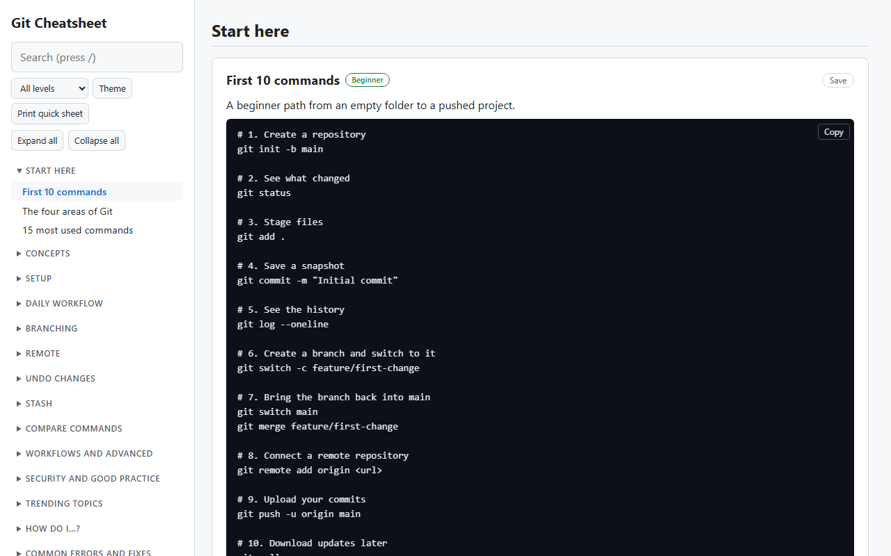

# Git Cheatsheet

A single-page, searchable cheatsheet of common Git commands and concepts.

## Usage

Open [git.html](git.html) in a browser. No build step or dependencies are needed. [index.html](index.html) redirects to it, so the folder also works as a website root.

- Press `/` to jump to the search box, and `Esc` to clear it. Matches are highlighted in the page.
- Use the search box to filter topics and commands, and the level filter to show Beginner, Intermediate, Advanced or Destructive topics.
- Use **Expand all** and **Collapse all** to open or close every group in the sidebar.
- In the interview section, answers are collapsed. Click a question to open it, or use **Show all answers** and **Hide all answers**. Searching opens the matching answers.
- Click **Copy** on any command block to copy it, or **Copy all** to copy every command of a topic.
- Click **Save** on a topic to keep it under Favourites in the sidebar. Recently opened topics are listed under Recent.
- Use **Theme** to switch between light and dark. By default it follows the system theme.
- Use **Print quick sheet** to print the "Start here" section on its own.
- Favourites, recent topics and the theme are stored in your browser only.
- Keyboard users can use the "Skip to content" link, which appears on the first `Tab`.

## Contents

- **Start here:** first 10 commands, the four areas of Git (diagram), 15 most used commands
- **Concepts:** Git vs GitHub, repositories, the `.git` directory, file states
- **Setup:** `config`, `init`, `clone`
- **Daily workflow:** `status`, `add`, `commit`, `log`, `blame`, `diff`, `show`, `grep`, `shortlog`, `archive`, `.gitignore` and `.gitkeep`, `rm`, `mv`
- **Branching:** `branch`, `switch`/`checkout`, `merge`, merge conflicts, `cherry-pick`, `rebase` (including `--onto` and `--update-refs`), `tag`
- **Remote:** `remote`, `fetch`, `pull`, `push`
- **Undo changes:** `restore`, `revert`, `reset`, `clean`, `reflog`
- **Stash:** `stash` and its options
- **Compare commands:** `merge` vs `rebase`, `reset` vs `revert` vs `restore`, `fetch` vs `pull`, `checkout` vs `switch` vs `restore`
- **Workflows and advanced:** branching strategies, Conventional Commits, interactive rebase, fixup/autosquash, pull request and fork workflows, `bisect`, `worktree`, submodules and subtree, shallow/partial/sparse clones, Git LFS, recovery with `reflog`, recommended config, line endings, linking commits to issues, PR and issue templates, releases and version tags
- **Security and good practice:** SSH keys and tokens, signed commits, keeping secrets out of history, branch protection and CODEOWNERS, safe force push
- **How do I...?:** step-by-step recipes for everyday problems such as undoing a commit, moving commits between branches and recovering a branch
- **Common errors and fixes:** detached HEAD, rejected pushes, `index.lock`, `Permission denied (publickey)`, dubious ownership and more
- **Practice exercises:** six hands-on exercises in a throwaway repository
- **Interview questions and answers:** about 80 questions in beginner, intermediate, advanced and scenario sections, plus a rapid-fire "which command?" table and tips for answering
- **Reference:** glossary and a table of the Git version each feature needs
- **Trending topics:** GitHub Actions, pre-commit hooks, GitHub CLI, AI-assisted Git, worktrees for parallel work, monorepo practices, supply-chain security, modern tooling, renaming `master` to `main`
- **What's new (Git 2.54 - 2.56):** `git history`, `git add --resolved`, `git branch --delete-merged`, config-based hooks, `git refs`, `git replay` and more

## Editing

Each topic in `git.html` is an `<article class="topic">` inside a `<section class="group">`.
The sidebar navigation is generated from those elements, so add a new topic by adding a new `article` with a unique `id`.
The level, destructive and version badges are set by id in the script at the end of the file.

## Publishing on GitHub Pages

1. Commit and push the files to the `main` branch.
2. On GitHub open **Settings**, then **Pages**.
3. Under **Build and deployment** choose **Deploy from a branch**, select `main` and the `/ (root)` folder, then save.
4. After a minute the site is available at `https://<user>.github.io/<repository>/`.

## License

[MIT](LICENSE)
